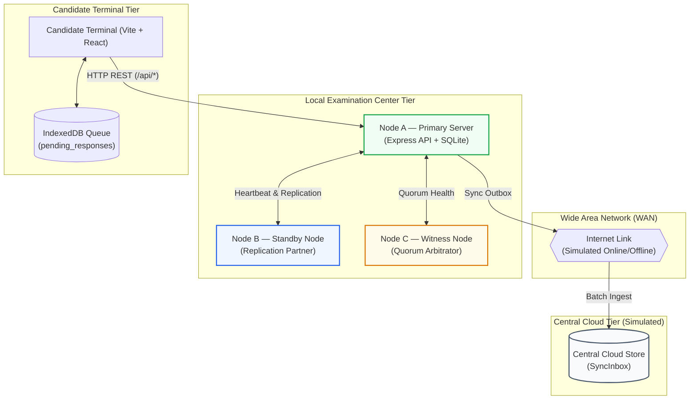
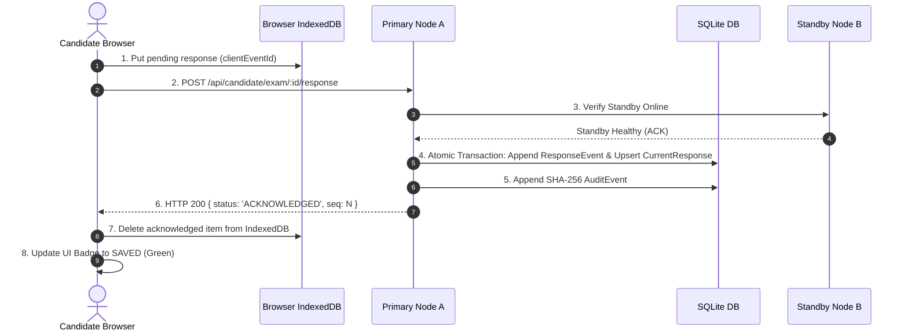
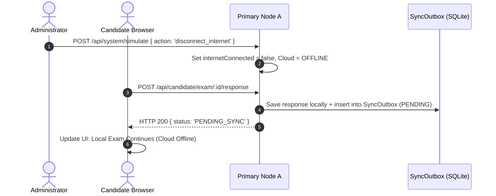
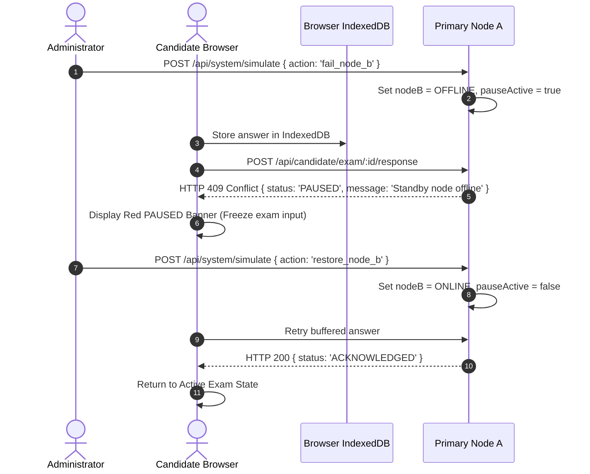

# 03 — System Architecture

**Project:** OneMind  
**Architecture Model:** Local Offline-First High-Availability Simulation  
**Version:** 1.0.0  

---

## 1. Architectural Overview

OneMind implements a layered, offline-first edge architecture designed for high-stakes examination centers. Instead of routing all interactions across the public internet to a distant cloud cluster, examination terminals connect to an in-center edge tier that maintains transactional persistence, standby redundancy, and an append-only audit trail.

---

## 2. Component Architecture

### 2.1 Candidate Client Terminal (Frontend)
- **Framework:** React 19, TypeScript, Vite, Tailwind CSS.
- **Client Storage:** Browser `IndexedDB` (`OneMindOfflineDB`) maintains an unacknowledged queue (`pending_responses`).
- **State Machine:**
  - Transitions through `INITIALIZING`, `ACTIVE`, `PENDING_ACK`, `SAVED_LOCAL`, `PAUSED`, and `SUBMITTED`.
  - Automatically recovers unconfirmed answers upon page reload or network recovery.

### 2.2 Local Center Edge (Primary Node A)
- **Runtime:** Node.js, Express, TypeScript.
- **ORM & Database:** Prisma ORM connected to SQLite (`prisma/dev.db`).
- **Transaction Engine:**
  - Executes atomic `$transaction` blocks for response ingestion.
  - Appends to immutable `ResponseEvent` history while updating `CurrentResponse` latest state.
  - Generates deterministic SHA-256 hash chains for `AuditEvent`.

### 2.3 Standby Node B & Safe-Pause Engine
- **Role:** Simulates the active replication partner.
- **Failure Protocol:** When Node B is marked `OFFLINE`, Node A enters `pauseActive = true`.
- **Honest Ingestion Rule:** If standby redundancy is unavailable, Node A refuses to return durable acknowledgement to the candidate (HTTP 409 Conflict), preventing single-point-of-failure data loss.

### 2.4 Central Cloud Aggregator (SyncInbox)
- **Role:** Simulates the upstream central repository where candidate results are consolidated after the examination window closes or when connectivity returns.

---

## 3. Core Data Flow & Failure Sequences

### 3.1 Normal Response Persistence Flow

---

### 3.2 Internet Disconnect & Offline Continuity Flow

---

### 3.3 Standby Node B Crash & Safe-Pause Protocol

---

## 4. SHA-256 Hash Chaining Architecture

Every event in the `AuditEvent` ledger incorporates the cryptographic digest of its immediate predecessor:

$$\text{currentHash}_n = \text{SHA-256}(\text{eventId}_n \parallel \text{type}_n \parallel \text{details}_n \parallel \text{currentHash}_{n-1} \parallel \text{candidateId}_n \parallel \text{sessionId}_n)$$

$$\text{currentHash}_0 = \text{SHA-256}(\text{eventId}_0 \parallel \text{type}_0 \parallel \text{details}_0 \parallel \text{"GENESIS"} \parallel \text{"system"} \parallel \text{"none"})$$

This structure guarantees that any retrospective alteration of a candidate's answer, score, or timestamp invalidates all subsequent hash links in the ledger.
