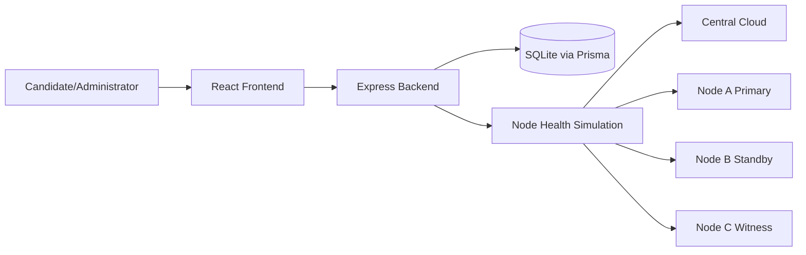
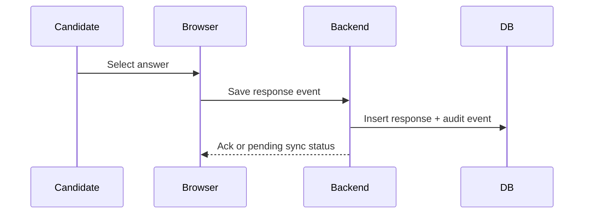
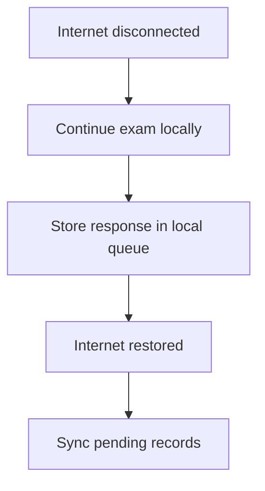
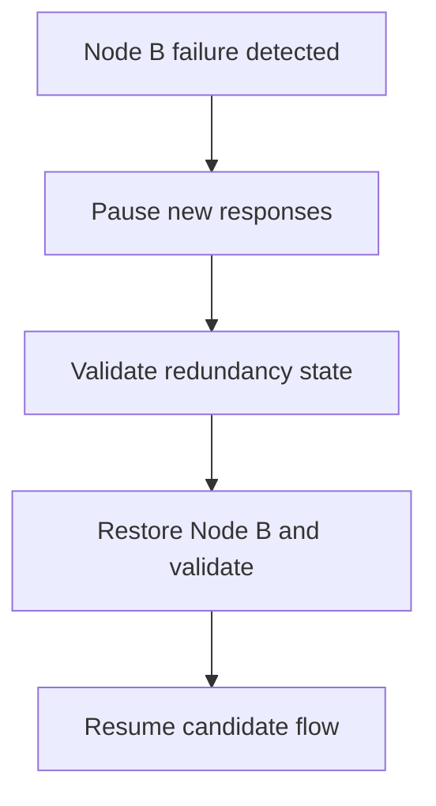

# 03 — System Architecture Document

## High-Level Architecture

The prototype keeps a local examination center operational even if the central cloud is unavailable. A browser-based candidate interface talks to a local backend, which stores exam and response data locally in a SQLite database via Prisma. System monitors model the cloud, Node A, Node B, and Node C states.

## Component Responsibilities

- Frontend: candidate and administrator interface.
- Backend API: user authentication, exam configuration, response validation.
- SQLite database: local storage for exam, session, and event state.
- Monitoring state: cloud and node health simulation and pause logic.

## Data Flow

1. Candidate logs in.
2. Session and questions are retrieved.
3. Answer events are saved locally.
4. If internet is available, responses are acknowledged.
5. If cloud is disconnected, responses remain pending for synchronization.

## Failure Handling

- Internet disconnect: continue exam locally.
- Node B offline: pause new response acknowledgement.
- Node C off: show witness/quorum warning.

## Mermaid Diagrams

