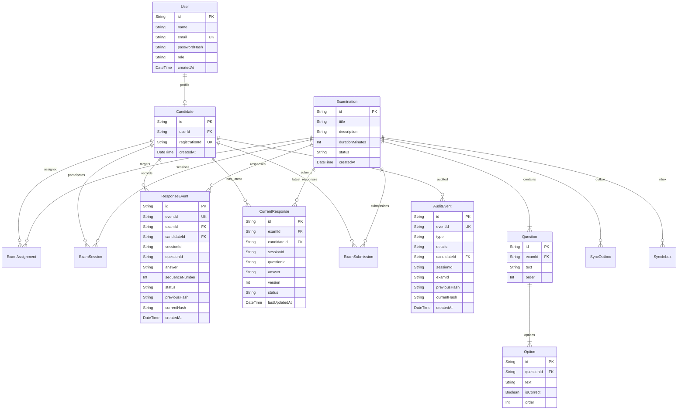

# 04 — Database Design & Entity Relationship

**Project:** OneMind  
**Database Engine:** SQLite (via Prisma ORM)  
**Schema Path:** `backend/prisma/schema.prisma`  
**Version:** 1.0.0  

---

## 1. Entity-Relationship Overview

The OneMind relational schema is optimized for auditability, transaction atomicity, and high-frequency answer persistence. It explicitly separates immutable event streams (`ResponseEvent`, `AuditEvent`) from mutable operational states (`CurrentResponse`, `ExamSession`).

---

## 2. Table Specifications & Indexes

### 2.1 `User`
Stores authentication credentials and roles (`ADMIN` or `CANDIDATE`).
- `id` (UUID PK)
- `email` (Unique VARCHAR)
- `passwordHash` (Salted scrypt hash: `scrypt:<salt>:<derivedKey>`)
- `role` (`ADMIN` | `CANDIDATE`)

### 2.2 `Candidate`
Links a candidate's user profile to their unique institutional `registrationId`.
- `id` (UUID PK)
- `userId` (FK -> `User.id`, Unique)
- `registrationId` (Unique VARCHAR, e.g. `CAND-101`)

### 2.3 `Examination`
Stores assessment configuration, title, duration, and status.
- `id` (UUID PK)
- `title` (VARCHAR)
- `description` (TEXT)
- `durationMinutes` (INTEGER)
- `status` (`ACTIVE` | `PAUSED` | `ENDED` | `DRAFT`)

### 2.4 `Question` & `Option`
Stores the examination question pool and multiple-choice options.
- `Question.text` (TEXT)
- `Question.order` (INTEGER)
- `Option.text` (VARCHAR)
- `Option.isCorrect` (BOOLEAN — strictly stripped before returning to candidate client)
- `Option.order` (INTEGER)

### 2.5 `ResponseEvent` (Append-Only Event Ledger)
Maintains the complete, immutable chronological history of all answer selections.
- `eventId` (Unique VARCHAR)
- `sessionId` (VARCHAR)
- `questionId` (VARCHAR)
- `answer` (TEXT)
- `sequenceNumber` (INTEGER)
- `status` (`ACKNOWLEDGED` | `PENDING_SYNC`)
- `previousHash` & `currentHash` (SHA-256 digests)
- **Constraint:** `@@unique([sessionId, questionId, sequenceNumber])`
- **Index:** `@@index([candidateId, examId])`

### 2.6 `CurrentResponse` (Latest State Cache)
Maintains the single current answer per question for fast candidate palette rendering.
- `candidateId`, `examId`, `questionId`
- `answer` (TEXT)
- `version` (INTEGER)
- `status` (`ACKNOWLEDGED` | `PENDING_SYNC`)
- **Constraint:** `@@unique([candidateId, examId, questionId])`

### 2.7 `AuditEvent` (Chained Audit Trail)
Stores system-wide security, lifecycle, and operational events.
- `eventId` (Unique VARCHAR)
- `type` (`ADMIN_LOGIN`, `CANDIDATE_LOGIN`, `EXAMINATION_CREATED`, `ANSWER_SAVED`, `INTERNET_DISCONNECTED`, `NODE_B_FAILED`, etc.)
- `details` (TEXT)
- `previousHash` (SHA-256)
- `currentHash` (SHA-256)
- **Index:** `@@index([candidateId, createdAt])`

### 2.8 `SyncOutbox` & `SyncInbox`
Manages store-and-forward synchronization between the local center and simulated central cloud.
- `SyncOutbox`: Queues offline events created while `internetConnected = false`.
- `SyncInbox`: Ingests synced records idempotently to prevent duplicate processing.
